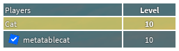

# leaderstats2

Leaderstats2 is a wrapper library that removes the baggage of handling leaderstats and teams on the player list. The default GUI that is provided emulates the 2015-2020 playerlist, however you can easily change or modify the GUI to what you want. The GUI folder also provides a few useful methods such as the default sorting engine.

    

## Features
* Wrapper library that supports players, teams and leaderstats
* Leaderstats through attributes (prefixed with `stat_`) and configurable
* Re-implementation of the 2015 Player List

## Usage
To use;
* Roblox Studio: Simply copy the built RBXM into Studio
* Rojo Project: Clone the "src" folder into your codebase
Make sure your the script syncs to `StarterPlayer.StarterPlayerScripts`

## Limitations
Currently, the player list cannot support attributes through the legacy `leaderstats` method (the implementation is weird). The 2015 Player list impl also does not contain the context menu feature

